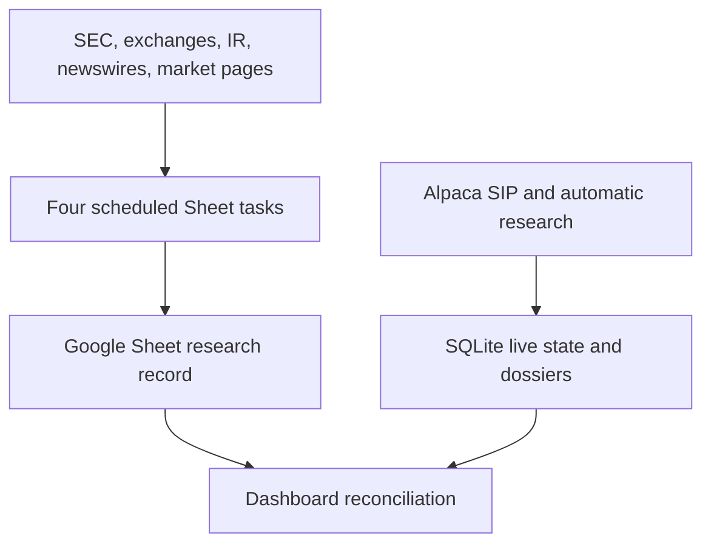

# Momentum Intelligence Trading Desk

## Spreadsheet data sources, scheduled tasks, data dictionary, lineage, and controls

**As of:** August 22, 2026 (Eastern Time)  
**Workbook:** [Trading Desk – Small Cap Momentum Watchlist](https://docs.google.com/spreadsheets/d/1YfuAbKH80aSJFLdpEHYZNMa15jew3fMkhVeaJQbUztQ/edit)  
**Scope:** The live Google workbook, its four active scheduled writers, and the production application’s relationship to the Sheet. Historical implementation details are identified as such; proposed features are not described as live.

---

> **STALENESS WARNING — READ BEFORE USING THIS FILE.**
>
> Dated **2026-08-22** and it describes all four scheduled tasks as ACTIVE.
> **Two were paused on 2026-08-23** — `9:25 Opening Spike Assessment` and
> `4:15 PM Close & Learn Momentum`. This report predates the pause by one day and
> says nothing about it, so every statement below about those two tasks is a
> description of what they *did*, not what they do.
>
> Committed into `docs/` on 2026-08-24 by the R&D thread, unmodified apart from
> this banner, so it can be cited by path and sha rather than by a filename with
> a `(1)` in it. It is a first-hand account of the workbook and a second-hand one
> of this application — see its own §13.

## 1. Executive summary

The Google Sheet is a **persistent, stage-based research record**. It is currently written by four weekday ChatGPT Work tasks at **10:00 PM, 6:10 AM, 9:25 AM, and 4:15 PM ET**. Those tasks use current web research, SEC and exchange material, issuer investor-relations pages, newswires, market-data pages, and the workbook’s own prior history. They write literal point-in-time values and prose into `TODAY`, `RESEARCH`, dated tabs, `ARCHIVE`, `OUTCOMES`, and `PATTERNS`.

The Sheet is **not the same data pipeline as the live AWS application**. The production application has a separate automatic path built around Alpaca SIP, deterministic market calculations, SQLite state, automatic SEC/catalyst research, and structured AI interpretation. The application reads and normalizes the Sheet, compares Sheet conclusions with automatic conclusions, and shows provenance/conflicts in the dashboard. The available evidence does not show the production application writing its automatic telemetry or dossiers back into the Sheet.

This distinction matters:

- **Market observations in the Sheet are task-collected point-in-time values from cited market/web sources**, sometimes cross-checked against Alpaca for outcomes and often stored with their source or uncertainty inside the cell. Percentage fields and risk metrics are calculated before being written.
- **Live Daily RVOL, AH Participation, ranks, live event state, halts, and continuous price telemetry belong to the application database**, not the current Sheet schema.
- The Sheet preserves the human-readable operating record and learning loop; the application supplies the continuously updated market layer.

The workbook currently has **15 tabs**, including nine dated reports. As inspected on August 22, `TODAY` held nine Friday after-hours names for the next session, with all morning columns blank as expected before the next 6:10 AM run. `RESEARCH` held 204 records, `ARCHIVE` 96, `OUTCOMES` 148, and `PATTERNS` seven maintained rows.

---

## 2. Current workbook inventory

| Tab or tab family | Current size | Function |
| --- | ---: | --- |
| `TODAY` | 9 ticker rows; 27 columns (`A:AA`) | Working watchlist. `A:S` is the 10:00 PM after-hours baseline; `T:AA` is the 6:10 AM confirmation layer. |
| Dated tabs | 9 tabs: Aug. 11–14 and Aug. 17–21 | Stage-preserving daily record. The tab is refreshed at 9:25 and updated at 4:15, then becomes historical after the session is finalized. |
| `RESEARCH` | 204 rows; 37 columns (`A:AK`); 146 unique tickers | Detailed evidence layer: catalyst, source links, float, filings, supply, splits, historical runs, levels, cycle reasoning, Dirty Float, and analyst notes. |
| `RULES` | 45 actual rule rows | Operating constitution: universe, sources, classifications, preservation rules, learning rules, and Dirty Float definitions. |
| `ARCHIVE` | 96 rows; 82 unique tickers | Central append-only archive of prior after-hours baselines. It stores `Trading Date` plus the baseline fields only. |
| `OUTCOMES` | 148 rows; 115 unique tickers | Forecast-versus-outcome ledger, component grades, pattern status, and Dirty Float outcome fields. |
| `PATTERNS` | 7 maintained rows plus header | Aggregate learning summary and patterns `P1`–`P6`; `P6` is the Dirty Float research series. |

The current `TODAY` baseline contains **OLOX, PMI, DXST, CYPH, PLAG, BTOG, GAUZ, CDTG, and BTCS**. Its `PM Price` through `PM Warning Shot` cells are blank because the next morning confirmation has not yet run.

Unless explicitly stated otherwise, every population and completeness count in this report excludes header rows and blank spacer rows. For example, `RESEARCH` has 204 data records even though its used range reaches row 206 because row 1 is the header and row 42 is blank.

Its current mix is **one B/Secondary, four C/Backside-Opportunistic, and four Avoid**; six are Frontside-Warning and three are Backside; two have B catalysts and seven have C/weak-or-none catalysts; seven are marked Dirty Float and two Unknown. There are no A/Primary, Fresh/Frontside, A/Strong-Fresh catalyst, or Clean Float rows in the current baseline.

The Sheet timezone is **America/New_York**. Historical tabs are preserved rather than regenerated from present-day facts.

### Dated-report population

| Dated tab | Baseline/watchlist | 9:25 opening rows | Actual leaders | Scorecard rows |
| --- | ---: | ---: | ---: | ---: |
| 2026-08-21 | 12 | 10 | 5 | 14 |
| 2026-08-20 | 15 | 10 | 5 | 22 |
| 2026-08-19 | 10 | 14 | 5 | 16 |
| 2026-08-18 | 9 | 17 | 5 | 24 |
| 2026-08-17 | 11 | 15 | 5 | 18 |
| 2026-08-14 | 8 | 14 | 5 | 13 |
| 2026-08-13 | 10 | 10 | 5 | 15 |
| 2026-08-12 | 8 | 12 | 5 | 15 |
| 2026-08-11 | 7 | 9 | 5 | 11 |

---

## 3. Active tasks that write the spreadsheet

All four active tasks are configured for Monday through Friday in `America/New_York`. Every task first checks whether the relevant U.S. session exists and skips mutation on a market holiday or non-session day.

| Scheduled time | Active task | What it does | Primary writes |
| --- | --- | --- | --- |
| **10:00 PM ET** | After-Hours Momentum Recap | Independently scans the available after-hours mover universe; researches catalyst, structure, cycle, history, levels, and priority; reads the learning layer before finalizing. | Archives the prior `TODAY`; replaces `TODAY!A:S`; clears stale `T:AA`; appends/updates detailed `RESEARCH`. |
| **6:10 AM ET** | Premarket Momentum Confirmation | Preserves the prior AH thesis, verifies every baseline name, independently finds new PM movers, checks overnight/weekend news and structure, then confirms, qualifies, or rejects the earlier thesis. | Preserves `TODAY!A:S`; fills `T:AA`; may add newly qualifying rows; updates `RESEARCH`; re-sorts by revised priority. |
| **9:25 AM ET** | Opening Spike Assessment | Runs a fresh premarket scan rather than starting from `TODAY`; evaluates potential movement in the first 1–5 RTH minutes, triggers, invalidation, liquidity, supply, and spike/chop/flush framing. | Creates/replaces a separate 16-column 9:25 section below the main table; refreshes the full `YYYY-MM-DD` dated tab. |
| **4:15 PM ET** | Close & Learn Momentum | Independently identifies the five core leaders by maximum percentage gain from the prior RTH close observed between premarket and 4:00 PM, preserves every prior call, grades decision usefulness, and updates the learning set. | Adds/refreshes `ACTUAL SESSION LEADERS` and `PREDICTION SCORECARD` in the dated tab; refreshes that session in `OUTCOMES`; updates `PATTERNS`. |

### Last observed execution timing

The tasks are exact-schedule tasks, but the last Friday run timestamps show queue/execution delay. These are the last recorded task timestamps, not a claim about every run.

| Task | Scheduled | Last observed, Aug. 21 ET | Approximate delay |
| --- | ---: | ---: | ---: |
| After-Hours Momentum Recap | 10:00 PM | 10:11 PM | 11 min |
| Premarket Momentum Confirmation | 6:10 AM | 6:23 AM | 13 min |
| Opening Spike Assessment | 9:25 AM | 9:41 AM | 16 min |
| Close & Learn Momentum | 4:15 PM | 4:33 PM | 18 min |

The configured time is therefore the intended checkpoint, while the stored source timestamps and actual task completion should be used when assessing freshness.

### Mutation and preservation rules

The tasks share five invariants. They do not start from a fixed ticker list; they preserve prior stage calls rather than rewriting them with hindsight; they use `Unknown` rather than inventing unavailable data; they preserve workbook formatting, validation, filters, and historical tabs; and they keep catalyst, structural risk, and momentum behavior as separate conclusions.

The Monday 6:10 task explicitly starts from the **Friday after-hours baseline plus weekend developments**. There is no separate 6:50 Sheet task.

---

## 4. Source inventory and source authority

### 4.1 Configured source order

The active tasks require this order of authority:

| Order | Source class | Intended use |
| ---: | --- | --- |
| 1 | **SEC EDGAR and filed exhibits** | Legally filed events, outstanding/share facts, registrations, offering terms, warrants, convertibles, resale eligibility, splits, and effective dates. |
| 2 | **Exchange notices and exchange data** | Listing/compliance notices, corporate actions, halts, and exchange-published information. Nasdaq and NYSE sources are specifically contemplated. |
| 3 | **Company investor relations / original issuer release** | Operating announcements, earnings, contracts, regulatory updates, financing announcements, and original timestamps. |
| 4 | **Original established newswires** | PR Newswire, GlobeNewswire, Business Wire, Accesswire/Access Newswire, and Newsfile. |
| 5 | **Reliable market-data and market-news pages** | Discovery, cross-checking prices/volume/history, and secondary confirmation when primary sources are absent or slower to surface. |

Every serious ticker is searched by both **ticker and full company name**. The 9:25 pass explicitly searches for releases and filings published after 6:10 AM. A same-morning 8-K, 6-K, 10-Q, earnings release, company announcement, or newswire item can be treated as fresh even if a market-data page has not yet incorporated it.

### 4.2 Market discovery sources used by the Sheet tasks

The tasks call for a complete *available* U.S.-tradable mover scan, but they do not pin one contractual scanner or vendor. The current workbook shows repeated use of **StockAnalysis and TradingView**, with occasional **QuoteMedia** references and outcome cross-checks against **Alpaca**. The 9:25 task requires at least two reliable current premarket gainer/volume sources where available.

This is a best-effort web-research universe, not a deterministic exchange-complete feed. Provider coverage, refresh time, extended-hours methodology, consolidated-versus-venue volume, corporate-action adjustment, and ticker availability can differ.

### 4.3 Sources actually persisted in the workbook

The `RESEARCH` and `OUTCOMES` source fields currently contain **928 URL appearances across 64 domains**. These are occurrence counts, not unique facts, searches, or requests; the same URL can appear repeatedly.

| Persisted domain | URL appearances | Typical role |
| --- | ---: | --- |
| `stockanalysis.com` | 505 | Float/statistics, price history, and outcome history. |
| `sec.gov` | 133 | Primary filings and exhibits. |
| `stocktitan.net` | 71 | Secondary SEC/news discovery or mirror. |
| `marketwatch.com` | 24 | Secondary market history/news. |
| `tradingview.com` | 24 | Extended-hours market snapshots/history. |
| `globenewswire.com` | 23 | Original newswire. |
| `prnewswire.com` | 20 | Original newswire. |
| `finance.yahoo.com` and regional Yahoo | 17 | Secondary market history/news. |
| `nasdaq.com` / `nasdaqtrader.com` | 13 | Exchange/market information. |
| Other issuer IR and secondary domains | 98 | Issuer pages, Reuters, Business Wire, Newsfile, Access Newswire, TipRanks, Investing, StreetInsider, Benzinga, and other discovery sources. |

The source policy is primary-first, but the persisted link mix is heavily weighted toward StockAnalysis and secondary discovery. A URL count does not establish source quality, and a secondary mirror should not silently become the authority for a filing or issuer announcement.

The same concentration appears when source fields are separated by function. The figures below are URL/domain appearances extracted from source cells, not unique rows or unique facts; one record can contribute more than one appearance.

| Source field | Most frequent persisted domains |
| --- | --- |
| Float source | StockAnalysis 157 appearances; SEC 10; MarketWatch 8; TradingView 8; Yahoo Finance 3. |
| Catalyst source | StockAnalysis 63; SEC 32; StockTitan 23; PR Newswire 11; GlobeNewswire 10; TradingView 6; Reuters 3; Business Wire 2; numerous issuer IR sites. |
| Structure sources | StockAnalysis 128; SEC 66; StockTitan 36; MarketWatch 14; GlobeNewswire 11; TradingView 9; Nasdaq 7; PR Newswire 7. |
| Outcome source | StockAnalysis 131; SEC 10; Yahoo Finance 7; StockTitan 5; Investing.com 4. |

### 4.4 Facts collected from filings and structure research

The task definitions make the structure pass a required procedural gate before a ticker receives a cycle label, priority, or scalp ranking. A populated row—especially one classified `Unknown`—does not by itself prove that every potentially relevant filing was found or that the review was complete. The pass seeks:

| Category | Data sought |
| --- | --- |
| Share base | Shares outstanding, public/displayed float, unrestricted/tradable shares, restricted/affiliate shares, and newly issued shares. |
| Registered supply | S-1/F-1, S-3/F-3, 424B prospectuses and supplements, EFFECT, registered resale blocks, and acquisition consideration shares. |
| Financing supply | Offerings, ATM capacity, PIPEs, equity purchase agreements/lines, preferred conversions, convertibles, pre-funded warrants, common warrants, and reserve mechanics. |
| Corporate actions | Reverse/forward splits, authorized-share changes, ADS ratios, and split-normalized historical values. |
| Eligibility and restrictions | Effective dates, holder restrictions, exercise/conversion conditions, closing/approval contingencies, and whether supply was eligible by the relevant session. |

The system must not substitute shares outstanding or market capitalization for public float. A shelf is capacity, `EFFECT` means registration effectiveness, and registered resale eligibility does **not** prove that holders are selling.

---

## 5. End-to-end Sheet lineage

### 5.1 After-hours baseline

The 10:00 PM task scans the available AH universe, selects meaningful names, and completes catalyst, structural, cycle, runner, and level research. Before replacing the working table, it appends the completed prior baseline to `ARCHIVE`. It then writes the new `TODAY!A:S`, clears morning cells `T:AA`, updates `RESEARCH`, and sorts the list. Existing `A:S` rows originate in this baseline; the 6:10 task can append new PM movers with explicit placeholders, so not every row present later in the morning necessarily existed at 10:00 PM.

The practical universe is generally a move beginning or becoming relevant at **$2–$10**, verified float below **20 million** when available, and meaningful price movement plus volume/liquidity. A qualifying stock stays in scope if the move carries it over $10 and is flagged `OUT OF PRICE RANGE`.

### 5.2 Morning confirmation

The 6:10 AM task preserves the baseline exactly. It checks every existing name and independently searches for new premarket movers. Existing names receive current PM price, change, volume, new catalyst/filing information, a confirmation state, revised priority, and a new warning. New movers can be appended with `Unknown` or `New PM mover — no AH baseline row` where genuine AH values do not exist.

### 5.3 Final pre-open assessment

The 9:25 task does not treat the earlier list as its discovery universe. It rescans current premarket gainers and volume, then evaluates the first 1–5 minutes after the open using current PM high/low, off-high percentage, last 5–15 minutes of price/volume behavior, spread/liquidity, catalyst, cycle, supply, trigger, and invalidation. Exceptional sub-$2 names can enter if they are genuine leaders and are flagged `BELOW CORE PRICE RANGE`.

The completed working view is copied into the dated tab. The dated tab is then the preserved forecast record used at the close.

### 5.4 Close and learning loop

At 4:15 PM, the task finds core leaders by **maximum percentage gain from the prior RTH close reached from premarket through 4:00 PM**, not by closing gain or raw dollar price. It records the actual leader table, grades each forecast stage, appends or refreshes `OUTCOMES`, and updates `PATTERNS`. Out-of-focus absolute leaders are written as explicit exclusions rather than silently mixed into the core universe.

No prior call is rewritten after the outcome is known.

### Direct, calculated, and interpreted data

| Data class | Examples |
| --- | --- |
| Direct market observation | RTH/AH/PM prices, volumes, highs/lows, peak window, RTH close, and observation time where recorded. |
| Filing/reference fact | Float, shares outstanding, publication timestamp, split history, SEC forms, offerings, ATMs, PIPEs, warrants, convertibles, and resale registrations. |
| Deterministically calculated before write | AH/PM percentage, off-PM-high, flush from high, peak gain, close gain, peak-to-close giveback, and Overhang/Float. |
| Reconciliation result | Provider ranges and source discrepancies preserved when current observations disagree materially. |
| Analyst/AI-derived | Priority, cycle, catalyst grade and summary, structure class, warning, key levels, confirmation, opening thesis, invalidation, execution framing, scores, pattern status, and next rule. |

The workbook has no consistent `Author`, `Generation Method`, or `Model/Rule Version` field, so a reader cannot identify from the row alone whether an interpreted value was written manually, by a scheduled model-assisted task, or by deterministic code.

---

## 6. Field-level data dictionary

### 6.1 `TODAY` after-hours baseline (`A:S`)

| Col. | Field | Meaning and lineage |
| --- | --- | --- |
| A | Priority | `A — PRIMARY`, `B — SECONDARY`, `C — BACKSIDE / OPPORTUNISTIC`, or `AVOID`; synthesized from catalyst, cycle, volume/liquidity, structure, and supply. |
| B | Ticker | U.S.-tradable symbol. |
| C | Country of Origin | Current primary operating headquarters or principal executive office; material legal-domicile differences go in `RESEARCH`. |
| D | Cycle | Fresh/frontside, frontside with warning, or backside. |
| E | RTH Close | Current session’s regular-hours closing reference. |
| F | AH Price | After-hours price snapshot used by the recap. |
| G | AH % | AH price change versus RTH close. |
| H | AH Volume | Intended window is 4:00 PM ET through the recap snapshot; cells often include the provider name. Some public pages use a differently bounded extended-hours or total-session figure, which must be retained as a source discrepancy rather than silently treated as identical. |
| I | Float | Sourced displayed/public float or an explicit `Unknown`/qualifier. |
| J | Catalyst Grade | `A — STRONG/FRESH`, `B — LEGITIMATE/SECONDARY`, or `C — WEAK/NONE`. |
| K | Catalyst | Concise event summary; exact fallback is `NO FRESH CATALYST FOUND`. |
| L | Catalyst Time | Publication/filing time and freshness context. |
| M | Recent Run High | Current/recent momentum-cycle high; historical resistance must remain separate. |
| N | Flush From High % | Pullback from the identified recent-cycle high, with uncertainty preserved. |
| O | Prior Runner | Former-runner, superrunner, halt, split, or prior-cycle context. |
| P | Structure Flags | Concise float/supply judgment, including Dirty Float and ratio/reason where applicable. |
| Q | Key Levels | Relevant support, resistance, current-cycle high, and split-aware historical levels in one concise cell. |
| R | Warning Shot | One decision-useful sentence identifying the dominant risk. |
| S | Notes | Mover potential, scalp quality, carry/knife-catcher risk, caveats, and unresolved issues. |

### 6.2 `TODAY` premarket confirmation (`T:AA`)

| Col. | Field | Meaning |
| --- | --- | --- |
| T | PM Price | Current premarket price at the confirmation snapshot. |
| U | PM % | Premarket change versus the prior session’s 4:00 PM RTH close; positive means above that close. |
| V | PM Volume | Intended window is 4:00 AM ET through the confirmation snapshot. Provider windows can differ and should be identified when known. |
| W | PM Catalyst/Update | Overnight or same-morning catalyst change, or confirmation that no newer event was found. |
| X | PM Catalyst Time | Exact publication/filing time or search cutoff. |
| Y | Confirmation | Exact state: `CONFIRMED`, `MIXED`, `FAILED`, or `NEW PM MOVER`, with the prescribed explanatory sentence. |
| Z | Revised Priority | Updated A/B/C/AVOID classification. |
| AA | PM Warning Shot | One concise current warning after the morning reassessment. |

`Confirmation` is a task-authored free-text classification. It is not the proposed derived **Live Confirmation** signal.

### 6.3 The 9:25 opening assessment section

| Field | Meaning |
| --- | --- |
| Rank; Ticker | Evidence-ranked opening list. |
| Decision | `BEST OPENING SPIKE`, `CONDITIONAL OPENING SPIKE`, `SCALP ONLY`, or `AVOID`. A best candidate is not forced. |
| Current PM Price; PM Change %; PM Volume; PM High; Off PM High % | Point-in-time pre-open market snapshot and retention. `PM Change %` is versus the prior RTH close; `PM Volume` is intended to cover 4:00 AM ET through the snapshot; `Off PM High %` is a positive drawdown magnitude from the PM high. |
| Catalyst Grade; Cycle | Independent catalyst and momentum-cycle conclusions. |
| Opening Spike Thesis | `SPIKE`, `CHOP`, or `FLUSH` framing and the reason. |
| Must Hold or Reclaim; Invalidation | Required price behavior and thesis-breaking level. |
| Spread/Liquidity | Tradability assessment; not a continuously refreshed spread feed. |
| Supply/Structure Risk | Float quality, overhang, issuance, and replenishment risk. |
| Opening Spike Plan | Conditional scenario for the first minutes, including a halt playbook when relevant. |

### 6.4 `RESEARCH` evidence schema (`A:AK`)

| Group | Exact fields | Purpose |
| --- | --- | --- |
| Identity and market snapshot | `Report Date`, `Ticker`, `Country of Origin`, `Company`, `RTH Close`, `AH Price`, `AH %`, `AH Volume` | Grounds the evidence in a specific research date and market snapshot. |
| Float | `Float`, `Float Source Date`, `Float Source URL`, `Shares Outstanding` | Keeps float distinct from shares outstanding and records source vintage. |
| Catalyst | `Catalyst Details`, `Catalyst Timestamp`, `Catalyst Grade`, `Catalyst Source URL` | Full event description, freshness, classification, and source. |
| Cycle and runner history | `Recent Cycle High`, `Flush From High %`, `Cycle Classification`, `Cycle Reasoning`, `Recent Major Runs`, `Historical Runner Notes`, `Split History` | Separates the current cycle from historical resistance and split-distorted prior runs. |
| Levels | `Daily Resistance`, `Daily Support` | Detailed daily levels underlying the concise `TODAY` ladder. |
| Filing and supply ledger | `8-K / 6-K`, `Registration / Prospectus`, `Offerings / ATM / PIPE`, `Warrants / Convertibles`, `Other Share Structure`, `Structure Source URLs` | Captures named supply sources and supporting documents. |
| Conclusions | `Warning Flags`, `Overall Priority`, `Analyst Notes` | Synthesized risk, priority, unknowns, and trading-relevant interpretation. |
| Dirty Float retrofit | `Float Quality`, `Overhang / Float`, `Supply Evidence` | Formal structural class, split-normalized supply ratio, and latent-versus-active evidence. |

### 6.5 Dated-tab outcome sections

The `ACTUAL SESSION LEADERS` table currently uses:

`Rank | Ticker | Prior RTH Close | Peak Price | Peak Gain % | Peak Window | RTH Close | Close Gain % | Peak-to-Close Giveback % | Volume | Detection Stage | Catalyst Grade | Float Quality | Overhang / Float | Actual Outcome`

The `PREDICTION SCORECARD` currently uses:

`Ticker | 10 PM Call | 6:10 AM Call | 9:25 AM Call | Leader Detection | Hold Decision | Cycle | Catalyst | Overall | Actual Outcome | Grade Reason | Next Rule | Float Quality | Overhang / Float | Dirty Float Outcome`

Dated tabs also preserve exclusions, source discrepancies, regime notes, the close summary, and the next rule for the following 10:00 PM scan.

### 6.6 `ARCHIVE`

`ARCHIVE` contains `Trading Date` plus the 19 after-hours baseline fields from `TODAY!A:S`. It does **not** centrally preserve `T:AA`, the 9:25 section, or close sections; those remain in the dated tabs.

### 6.7 `OUTCOMES` (`A:AB`)

| Group | Exact fields |
| --- | --- |
| Forecast identity | `Session Date`, `Forecast Pass`, `Ticker`, `10 PM Call`, `6:10 AM Call`, `9:15 AM Call` |
| Actual market outcome | `Actual Peak Rank`, `Prior RTH Close`, `Peak Price`, `Peak Gain %`, `Peak Window`, `RTH Close`, `RTH Close %`, `Peak-to-Close Giveback % (of move)`, `Volume`, `Reported By` |
| Scores | `Leader Detection (0-3)`, `Hold Decision (0-3)`, `Cycle (0-3)`, `Catalyst (0-3)`, `Overall (0-3)` |
| Interpretation | `Actual Outcome`, `Pattern Status`, `Grade Reason`, `Source` |
| Dirty Float outcome | `Float Quality`, `Overhang / Float`, `Dirty Float Outcome` |

The `9:15 AM Call` label is stale; the process has used 9:25 AM since August 14.

### 6.8 `PATTERNS` (`A:N`)

`Pattern ID | Pattern Name | Definition | Sessions Observed | Ticker Count | Peak Top-5 Count | Spike/Fade Count | Strong Retention Count | Average Peak Gain % | Average Giveback % (of move) | Current Status | Next-Day Follow-through | Last Updated | Current Evidence`

The current rows are a summary plus `P1`–`P6`. `P6` means the **row identified as P6**, not column P. At inspection, P6 covered nine sessions and 87 classifications, including 27 peak-top-five observations, 55 spike/fade observations, and 13 strong-retention observations. Its status remains `EMERGING`; the Sheet explicitly says it lacks a CLEAN comparator and does not establish that registered supply was actively sold.

### 6.9 `RULES`

The schema is `Section | Rule | Standard`. It contains the governing universe, source order, catalyst/cycle/priority definitions, archive rules, unknown-data policy, learning-layer instructions, and Dirty Float methodology.

---

## 7. Controlled definitions and formulas

### Sheet percentage fields and volume windows

Let $C$ be the prior session's 4:00 PM RTH close, $P$ the relevant snapshot price, $H_{PM}$ the premarket high, and $H_{cycle}$ the identified recent-cycle high. The stored percentages use these conventions:

| Field | Calculation and sign convention |
| --- | --- |
| `AH %` | $100 \times (P_{AH}/C - 1)$. Positive is above the same session's RTH close. |
| `PM %` / `PM Change %` | $100 \times (P_{PM}/C - 1)$. Positive is above the prior session's RTH close. |
| `Off PM High %` | $100 \times (H_{PM}-P_{PM})/H_{PM}$. It is recorded as a positive drawdown magnitude; zero means the snapshot is at the PM high. |
| `Flush From High %` | $100 \times (H_{cycle}-P)/H_{cycle}$ using the reference price named in the row. It is normally a positive drawdown magnitude; the chosen high and reference price must be stated when ambiguous. |
| `Peak Gain %` | $100 \times (P_{peak}/C - 1)$. Positive is above the prior RTH close. |
| `Close Gain %` / `RTH Close %` | $100 \times (P_{close}/C - 1)$. Positive is above the prior RTH close. |

The intended Sheet volume windows are **4:00 PM ET through the snapshot for `AH Volume`** and **4:00 AM ET through the snapshot for `PM Volume`**. Public providers do not always use identical sessions, venue coverage, corporate-action adjustments, or refresh cutoffs. If the task cannot verify an equivalent window, it should retain the provider name, range, or discrepancy rather than present the figures as interchangeable.

### Discovery and market metrics in the automatic application

The live application’s deterministic discovery layer uses:

$$
\text{Daily RVOL} = \frac{\text{cumulative volume since 04:00 ET}}{\text{average full-session volume over the prior 20 eligible sessions}}
$$

It is deliberately **not time-of-day normalized**. Premarket and RTH rank the eligible universe cross-sectionally by Daily RVOL. The base application universe is approximately $1–$20; once a name qualifies, it can remain latched if it moves outside that band.

After the RTH close, the automatic board uses:

$$
\text{AH Participation} = \frac{\text{volume since the current RTH close}}{\text{average full-session volume over the prior 20 eligible sessions}}
$$

`AH %` is price versus the current day’s RTH close. Daily RVOL remains context rather than the AH rank. A known zero-AH-volume name is unranked; an unknown denominator remains unknown rather than becoming zero.

These metrics are application/database fields, **not current Sheet columns**.

### Dirty Float

The formal Sheet ratio is:

$$
\text{Overhang / Float} =
\frac{\text{distinct eligible resale shares} + \text{distinct currently available share-equivalent supply}}
{\text{verified public float}}
$$

All quantities must be split-normalized, effective, and legally/operationally eligible as of the session. Numerator blocks must be distinct: exclude shares already represented in the verified public float, and do not count the same underlying shares again through both a resale registration and the associated warrant, convertible, or financing instrument. A generic dollar shelf cannot be converted into shares without usable terms.

| Result | Rule |
| --- | --- |
| `CLEAN FLOAT` | Affirmative review of the split-adjusted share base and material supply sources finds no material latent supply. Absence of evidence is insufficient. |
| `DIRTY FLOAT` | Quantified supply is at least 1.0× verified float, or issuance/split mechanics make displayed float materially unreliable. |
| `HIGH-RISK DIRTY FLOAT` | Ratio is at least 2.0×. |
| `UNKNOWN` | The denominator or eligible supply cannot be verified. Unknown is never promoted to Clean. |

Dirty Float is a structural risk class, not a directional forecast and not an automatic `AVOID`. A name may simultaneously have high mover potential, acceptable conditional scalp quality, and extreme carry risk.

### Peak-to-close giveback

$$
\text{Giveback} = 1 -
\frac{\text{RTH close} - \text{prior RTH close}}
{\text{peak price} - \text{prior RTH close}}
$$

The metric is meaningful only when the peak is above the prior RTH close. If peak equals prior close, the denominator is zero; if peak is below prior close, there was no positive peak move to give back. In either case, or when the peak window or source is unreliable, the field should be `Unknown`/`N/A` with an explanation rather than a forced percentage.

### Classification standards

| Dimension | Controlled values |
| --- | --- |
| Catalyst | `A — STRONG/FRESH`; `B — LEGITIMATE/SECONDARY`; `C — WEAK/NONE`; exact no-news text: `NO FRESH CATALYST FOUND`. |
| Momentum cycle | `🟢 FRESH / FRONTSIDE`; `🟡 FRONTSIDE — WARNING`; `🔴 BACKSIDE`. A green AH/PM print does not reset a failed cycle. |
| Priority | `A — PRIMARY`; `B — SECONDARY`; `C — BACKSIDE / OPPORTUNISTIC`; `AVOID`. |
| Premarket confirmation | `CONFIRMED`; `MIXED`; `FAILED`; `NEW PM MOVER`. |
| Opening decision | `BEST OPENING SPIKE`; `CONDITIONAL OPENING SPIKE`; `SCALP ONLY`; `AVOID`. If none qualifies, say `NO CLEAN OPENING SPIKE CANDIDATE`. |
| Pattern status | `NONE`; `EMERGING`; `ACTIVE`; `EXHAUSTION`, always with observed sample size. |
| Outcome grades | 3 = decision-useful; 2 = partly useful; 1 = weak; 0 = miss/unsupported. `Overall` measures decision usefulness, not P&L. |

A `FORMER SUPERRUNNER` is based on split-aware prior parabolic behavior, halt sequences, extreme low-volume squeezes, abnormal spreads, or violent collapses. `SUPERRUNNER SYMPATHY` is a temporary prior-1–3-session regime observation, never a fresh catalyst.

---

## 8. Data format, provenance, and current completeness

### Storage format

The workbook is primarily a **snapshot document**, not a normalized numerical database. Current `TODAY` values such as `$2.09`, `+7.18%`, and `1.89M TradingView` are stored as strings. Prices can be ranges; float carries qualifiers; levels are concatenated prose; multiple source URLs can be pipe-delimited inside one cell; and `Unknown` can coexist with explanatory text.

Across the used workbook ranges, the only formulas found were six legacy `=DATE(2026,8,10)` cells in `RESEARCH!A2:A7`. Every other populated cell—including derived metrics such as giveback—was written as a static value rather than a native Sheet formula. Those cells mix sourced facts, calculations performed before write, and authored interpretations. `RESEARCH` and `OUTCOMES` also mix numeric and string types by vintage.

That design is readable for a trader but requires parsing and normalization before rigorous aggregation or model training.

### Current completeness

| Field set | Coverage | Interpretation |
| --- | ---: | --- |
| `RESEARCH` total | 204 / 204 rows | Current inspected research population. |
| Float populated | 204 / 204 | 68 values still contain Unknown/unverified language. |
| Shares outstanding populated | 204 / 204 | 49 contain Unknown/unverified language. |
| Catalyst source populated | 199 / 204 | Five blank source cells. |
| Structure source field populated | 204 / 204 | “Populated” does not guarantee a primary URL or independent validation. |
| Dirty Float fields in `RESEARCH!AI:AK` | 175 / 204 (**85.8%**) | The retrofit is absent from all Aug. 10–11 rows and almost all Aug. 12 rows. |
| Overhang/Float in those 175 rows | 175 / 175 | 147 contain Unknown/unverified language. |
| Dirty Float fields in `OUTCOMES!Z:AB` | 127 / 148 (**85.8%**) | Twenty-one early outcome rows remain blank. |

The 204 `RESEARCH` rows currently contain **87 exact `DIRTY FLOAT`, 85 exact `UNKNOWN`, three exact `CLEAN FLOAT`, and 29 blank** classifications. `HIGH-RISK` appears in ratio/evidence prose rather than as a separate `Float Quality` value, so it is not an additional classification count. Catalyst-grade rows are 35 A, 46 B, and 123 C. Cycle rows are 19 Fresh, 87 Warning, 75 Backside, 22 Unknown, and one nonstandard `BACKSIDE / WARNING`. These are record counts rather than unique-ticker counts because the table contains multiple workflow stages and three duplicate date/ticker keys. The seven current `TODAY` Dirty Float rows are counted by the explicit `DIRTY FLOAT` label in `Structure Flags`; any high-risk wording is a qualifier inside that field, not a fifth controlled class.

The 148 `OUTCOMES` records have the following score distribution:

| Score dimension | 0 | 1 | 2 | 3 | Blank/— |
| --- | ---: | ---: | ---: | ---: | ---: |
| Leader Detection | 24 | 13 | 63 | 48 | 0 |
| Hold Decision | 19 | 4 | 20 | 100 | 5 |
| Cycle | 20 | 2 | 26 | 95 | 5 |
| Catalyst | 22 | 1 | 7 | 113 | 5 |
| Overall | 24 | 1 | 31 | 92 | 0 |

### Provenance rules

Each material claim should retain the source, source date/time, whether the value is complete or estimated, whether a split or corporate action can distort it, and whether a later value is being improperly applied to an earlier session. Conflicting sources are to be preserved and explained rather than silently averaged.

Volume is **share-transfer activity**, not proof that an equivalent number of unique shares has been absorbed. Registration, exercise capacity, or a financing facility is **latent/eligible supply**, not proof of current selling. Static Structure, Absorption, Replenishment Risk, Live Character, Chop Risk, Flush Risk, and Confidence must remain distinct even when the current Sheet only has room to express some of them in prose.

The tasks do not have a live Level 2 source. Halt bid/offer behavior is written as a condition for the trader to observe, not as a claimed live imbalance.

---

## 9. The Sheet versus the live application

### Automatic/live pipeline

Project readouts from August 18–21 describe the production architecture as:

- Alpaca SIP market worker → deterministic Demand Engine → SQLite WAL live state.
- SEC/public-source collection → catalyst/issuer resolution → structured interpretation → persisted ticker dossiers.
- Desk Assessment scheduler → immutable checkpoint snapshots and material change classes.
- Sheet provider + automatic state → provenance-aware state merge → Next.js dashboard.

Explicitly recorded SQLite tables include `rvol_baseline`, `minute_bars` with a three-day live retention window, `daily_bars` with a 90-trading-day research window, `ticker_session`, `desk_events`, `feed_health`, `universe`, `meta`, `research_jobs`, assessment records, and model-usage records. Later schema details should be verified from the repository before being treated as a formal current data contract.

The automatic research lifecycle includes `DEMAND DETECTED → ANALYSIS PENDING → COLLECTING SOURCES → ANALYZING → intelligence available`, with partial, failed, Sheet-only, auto-only, agreement, and conflict states kept distinct. A genuine Sheet-versus-Auto dispute can be adjudicated; human conclusions are not silently overwritten.

### Internal application checkpoints that do not equal Sheet writes

The application has historically persisted additional internal assessments at 6:25, 6:45, 7:00, every 30 minutes during RTH, and the RTH close, alongside 22:00, 6:10, and 9:25 checkpoints. Those are SQLite/dashboard snapshots. They should not be reported as additional Google Sheet automation runs.

### Current feature boundary

| Concept | In current Sheet | In automatic app/readouts | Status |
| --- | --- | --- | --- |
| Catalyst, cycle, priority, float, levels, warning | Yes | Yes | Implemented through two provenance paths. |
| Dirty Float, Overhang/Float, supply evidence | Yes | Automatic structure/supply ledger also exists | Implemented, but early Sheet history is only 85.8% backfilled. |
| Daily RVOL, AH Participation, live rank, continuous telemetry | No | Yes | Application-only. |
| Halt/events and persistent market changes | No dedicated Sheet field | Yes | Application/event layer. |
| `Confirmation` | Yes, task-authored text | Sheet value can be displayed/reconciled | Not a derived live structural signal. |
| Chop Risk and Flush Risk | No explicit columns | Audit found no production implementation | Prompted as conclusions/prose; predictive system not built. |
| Absorption, replenishment, effective float turnover | No explicit columns | Not established as live derived metrics | Research/proposed. |
| ±VWAP and Blue Sky alert | No | Not established in inspected production | Product/UI request, not current data lineage. |

The stated longer-term direction is to make the automatic database/research system authoritative and remove Sheet polling only after remaining Sheet-only intelligence and historical workflow have been migrated safely.

---

## 10. Confirmed inconsistencies, unresolved semantics, and schema drift

These are current workbook observations, not hypothetical risks. Where the workbook does not define a field's semantics tightly enough to decide whether a value is wrong, the uncertainty is stated explicitly.

| Issue | Exact evidence | Consequence |
| --- | --- | --- |
| **Aug. 14 dated-tab rows conflict with the archive date** | The eight names in the `2026-08-14` baseline—DARE, TPCS, AKAN, WETO, BOXL, ONFO, SXTC, and LBGJ—appear in `ARCHIVE` with `Trading Date = 2026-08-13`; `ARCHIVE` has no Aug. 14 value. This is wrong if `Trading Date` means the target session, but could reflect the prior evening's AH research date. The workbook does not define the distinction. | Date-based analysis is ambiguous until `Research Date` and `Target Session` are separated. Do not silently rewrite these rows without first fixing the field definition. |
| **9:15/9:25 label mismatch** | `OUTCOMES!F1` and one `RULES` entry still say `9:15 AM Call`; dated scorecards use `9:25 AM Call` from Aug. 14 onward. | Stage attribution is semantically stale and can mislead downstream analysis. |
| **RESEARCH has duplicate date/ticker rows without a stage key** | Examples: DOGZ on Aug. 12; HOWL and SNSC on Aug. 21 have multiple materially different rows for the same date. | These may be valid stage snapshots, but there is no `Pass`, `Stage`, `Version`, or `As Of` key to identify which is 10 PM, 6:10, or 9:25. |
| **Dirty Float retrofit is incomplete** | 29 of 204 `RESEARCH` rows and 21 of 148 `OUTCOMES` rows lack the added fields. | Historical comparisons are left-censored toward later sessions. |
| **No explicit report date or update timestamp in `TODAY`** | `TODAY!A1:AA1` contains field headers only. | A copied/exported table cannot prove which target session or pass produced it without workbook context. |
| **Historical dated-tab schemas drift** | Actual-leader headers changed on Aug. 13, 19, and 21; Dirty Float columns were added after Aug. 12; some dates add optional source fields. | Cross-date analysis needs a version-aware normalization step. |
| **No Aug. 10 dated tab** | Aug. 10 exists in `ARCHIVE` and `RESEARCH`, but not as a full dated report. | The first baseline lacks the full preserved multi-stage daily view. |

`PATTERNS` currently reports 45 peak leaders, 35 spike/fade observations, and 11 strong-retention observations. Those last two counts sum to 46. They may overlap, but the Sheet does not define whether the categories are mutually exclusive; this is an ambiguity, not proof of a calculation error.

---

## 11. Historical reliability events that affected lineage

These events are included because they explain why provenance, timestamps, and separation of systems are necessary. They are not assertions that the same fault is active now.

| Event | What happened | Data-lineage implication |
| --- | --- | --- |
| Overnight trading-date rollover | A long-running market worker updated session phase but retained its startup trading date, writing fresh SIP observations into the prior date. A rollover fix and regression tests were later reported. | Trading date must be resolved before every write boundary, not only at process start. |
| Sheet parser/universe incident | The provider misread a text cell such as `OBSERVED PM` as a symbol. One invalid symbol poisoned an Alpaca batch, caused a rapid failure loop, and contributed to missing close state. The reported fix added header-signature parsing, fail-closed cache behavior, universe admission, provider quarantine, and safer latch handling. | Sheet parsing is an external-ingestion boundary and must reject malformed rows without blocking market capture. |
| Catalyst misses | XOS and ENRD were missed because the IR resolver was not actually called in production; later changes wired the resolver into production and added issuer/company-source handling. | A configured source hierarchy is not evidence of coverage unless every collection path executes and records its result. |
| OpenAI interpretation 429 outage | Forty-seven research jobs failed at the interpretation stage; nine tickers later required manual requeue. | “No intelligence” during the outage meant analysis unavailable, not “nothing found.” |
| Research job explosion | One Aug. 18 investigation found more than 400 jobs for 67 tickers, driven largely by recovery sweeps, process restarts, resolver-version churn, and terminal-state dedup release. | Trigger, purpose, retry, model usage, and evidence fingerprint need durable attribution. |
| 22:00 recap/date transition | A prior rollover allowed both candidate dates to advance at the recap boundary, risking a skipped recap. Later readouts described restoration/pinning. | The after-hours source date and next target trading date must be stored separately. |

---

## 12. Reporting conclusions and cleanup priorities

The workbook successfully preserves four distinct things that should remain separate: **what the market did, what the research found, what the desk concluded at each checkpoint, and how that conclusion performed**. Its strongest qualities are historical preservation, explicit unknowns, filing-linked structural work, and refusal to equate registered supply with active selling.

The main data weakness is that the Sheet evolved from an operating document into a research dataset without acquiring a stable normalized key structure. The most useful cleanup sequence is:

1. Define `ARCHIVE.Trading Date` as either AH research date or target session, add the missing counterpart field, then resolve the Aug. 13/Aug. 14 conflict; rename the stale 9:15 fields/rule to 9:25 without rewriting any forecast values.
2. Add immutable `Trading Date`, `Assessment Stage`, `As Of ET`, and `Record Version` fields to every research/output record.
3. Separate numeric value, unit, source, and confidence instead of embedding all four in strings such as `1.89M TradingView`.
4. Backfill Dirty Float fields only from point-in-time evidence, with a backfill flag; do not make later structure appear to have been known earlier.
5. Publish a canonical source registry that distinguishes primary authority, original newswire, validated issuer source, secondary discovery, and rejected/mirror sources.
6. Decide whether the Sheet remains a permanent human-review layer or becomes a migration artifact. Until that decision, preserve Sheet/AUTO provenance and conflict handling.

---

## 13. Verification boundary for this report

This report was grounded in the live workbook, current active task definitions, and project artifacts/readouts from August 16–21. The local workspace did not contain the current `mointel` Git repository, and the live read-only MomoIntel connection returned an expired-session response. Therefore, this document does **not** claim a current production commit, live service health, current database row count, or exact deployed schema beyond what the live Sheet and active tasks expose.

Offline viscosity/tick research datasets—DataBento event data, `momo_arch_sec`, historical venue-specific archives, and the Phase 2B Alpaca event extraction—are **not evidenced as inputs to the current Sheet**. SCANZ and Webull are trader discovery/execution tools, not confirmed spreadsheet feeds.
